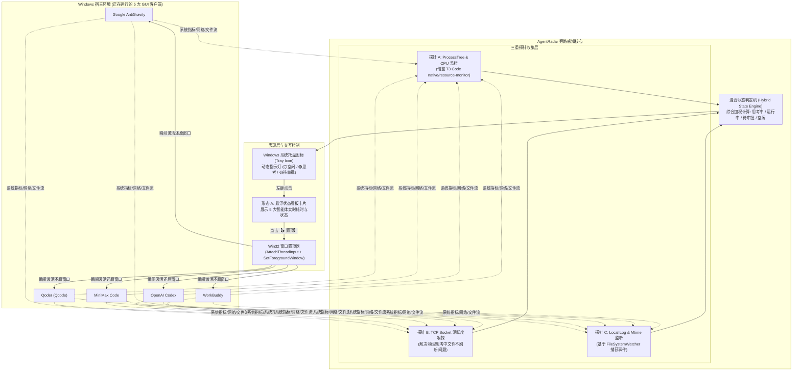
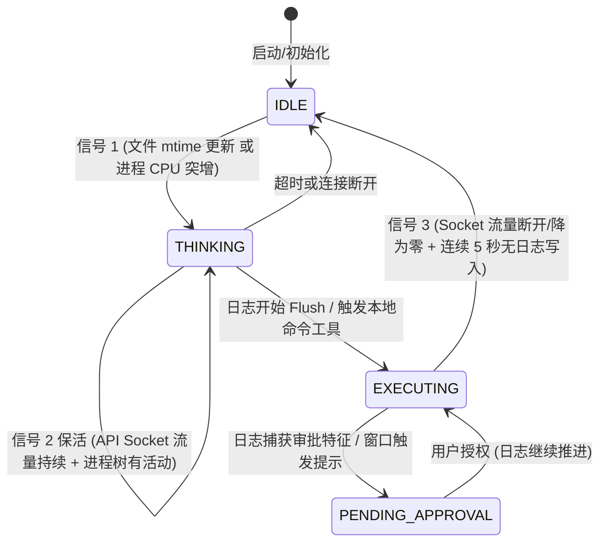

# AgentRadar 系统详细设计与技术规格说明书 (DESIGN.md)

> **版本**：v0.1.0  
> **状态**：Draft / 架构设计完成  
> **更新时间**：2026年10月  
> **文档归档路径**：`E:\BaiduSyncdisk\LocalHub\AgentRadar\docs\DESIGN.md`

---

## 目录
1. [背景与核心差异点（GUI Agent vs CLI Agent）](#1-背景与核心差异点)
2. [总体系统架构与数据流向](#2-总体系统架构与数据流向)
3. [目标 5 大 GUI 智能体特征全景矩阵](#3-目标-5-大-gui-智能体特征全景矩阵)
4. [混合状态感知引擎（Hybrid Sensing Engine）](#4-混合状态感知引擎)
5. [Windows 窗口激活与防锁死置顶机制](#5-windows-窗口激活与防锁死置顶机制)
6. [产品形态 A：系统托盘 HUD 规格定义](#6-产品形态-a系统托盘-hud-规格定义)
7. [技术栈选型与模块实现规划](#7-技术栈选型与模块实现规划)

---

## 1. 背景与核心差异点

### 1.1 为什么 T3 Code 的模式不能直接照搬？
在之前的调研中我们看到，**T3 Code** 采用的是 **“父进程托管模式（Parent-Child Spawning）”**：
* T3 Code 自己作为父进程，通过操作系统标准管道（`stdio`）亲自拉起智能体的 **CLI 版本**（如 `claude.exe` 或 `agy_acp_server.exe`）；
* 因为它是父进程，所以它能天然拦截每一个输出字符（stdout），从而实时掌握状态。

### 1.2 本项目的现实场景：纯 GUI 桌面应用
在用户的实际开发流中，运行的不是终端黑框，而是 **独立运行的桌面 GUI 软件**：
1. **Google AntiGravity**：独立打开的 IDE 窗口；
2. **Qoder (Qcode)**：独立运行的百度/千帆代码编辑器；
3. **MiniMax Code (Midmax code)**：独立运行的 MiniMax 官方桌面编程客户端；
4. **OpenAI Codex**：独立的 Codex 桌面客户端；
5. **WorkBuddy**：独立的桌面协同智能体客户端。

> **核心挑战**：
> 作为后启动的第三方小工具，我们**不是它们的父进程**，不能直接通过 `pipe` 读管道。我们必须作为操作系统的 **“旁路观察者（Sidecar Observer）”**，通过系统探针获知它们谁在思考、谁在执行、谁在等待审批！

---

## 2. 总体系统架构与数据流向



---

## 3. 目标 5 大 GUI 智能体特征全景矩阵

经实机扫描与底层路径溯源，本机 5 大 GUI 框架的全部关键技术指标已建立确切映射：

| 智能体 | 进程可执行文件名 | 默认安装绝对路径 | 本地状态/日志持久化目录 (AppData/Roaming) | 上游大模型 API 域名/端口特征 |
| :--- | :--- | :--- | :--- | :--- |
| **AntiGravity** | `Antigravity.exe` | `C:\Users\pc\AppData\Local\Programs\antigravity\` | `AppData/Roaming/Antigravity`<br/>`~/.gemini/antigravity/` | `generativelanguage.googleapis.com:443`<br/>`*.google.internal` |
| **Qoder** | `Qoder.exe` | `e:\Qoder\` | `AppData/Roaming/qoder`<br/>`AppData/Roaming/com.qoder.app.stable` | `aip.baidubce.com:443`<br/>`qianfan.baidubce.com:443` |
| **MiniMax Code** | `MiniMax Code.exe` | `D:\Users\pc\AppData\Local\Programs\MiniMax Code\` | `AppData/Roaming/MiniMax Agent`<br/>`AppData/Roaming/MiniMax` | `api.minimax.chat:443`<br/>`api.minimaxi.com:443` |
| **OpenAI Codex** | `codex.exe`<br/>`codex-code-mode-host` | `C:\Users\pc\AppData\Local\OpenAI\Codex\bin\` | `AppData/Roaming/Codex`<br/>`~/.codex/` | `api.openai.com:443`<br/>`chatgpt.com:443` |
| **WorkBuddy** | `WorkBuddy.exe` | `D:\WorkBuddy\` | `AppData/Roaming/WorkBuddy`<br/>`~/.workbuddy/` | 专有业务网关端口 / 内部 RPC |

---

## 4. 混合状态感知引擎（解决“思考中无日志刷新”难题）

### 4.1 传统单一监听手段的缺陷
* **仅看 CPU**：智能体如果因为死循环或者前端动效卡死，CPU 也会高，容易误判为正在思考；
* **仅看文件大小**：大模型处于长链思考（Extended Thinking / o1/o3-mini / Claude 3.7 Thinking）时，流式未触发 Flush，日志文件大小会在数秒内静止不变，导致被误判为“已跑完”；
* **仅看网络连接**：长连接池在闲置时也可能保持 `ESTABLISHED`。

### 4.2 三重加权状态机算法设计

我们设计了一个**时序驱动的有限状态机（FSM）**：



#### 判定步骤：
1. **即时激活（Trigger Phase）**：
   * 监听各框架在 `AppData/Roaming/<Agent>/logs` 或对应 `storage.json` 的修改时间戳（`LastWriteTime`）。
   * 用户在 GUI 输入框按回车的瞬间，客户端必定先记录本地 Turn，时间戳瞬间跳变，状态在 **0.1 秒内切为 🟢 THINKING**。
2. **长思考保活（Keep-Alive Phase）**：
   * 即使文件暂未写入，探针周期性（每秒）检查目标进程的 **TCP Socket 连接状态**；
   * 若对应到上述 API 目标地址的连接保持在活跃传输状态（通过 Windows `GetExtendedTcpTable` 读取），状态机强制锁定在 **🟢 THINKING（思考中）**，计时器持续计数。
3. **审批拦截捕获（Approval Detection）**：
   * 探针正则扫描最新写入的日志行：
     * `approval_required`、`confirm_command`、`allow_execute`、`waiting_user_input`；
   * 一旦匹配，状态机立刻切为 **🟡 PENDING_APPROVAL（等待确认）**，托盘变黄并支持桌面通知提醒。

---

## 5. Windows 窗口激活与防锁死置顶机制

### 5.1 Windows 的“前台窗口锁定限制”
从 Windows 98/2000 开始，微软出于防流氓软件骚扰考虑，引入了前台窗口锁：
* 如果一个后台进程（如我们的托盘小工具）试图调用 `SetForegroundWindow(target_hwnd)`，Windows 会默认**拦截置顶**，仅仅让任务栏上的目标图标变成黄色闪烁，无法直接把窗口拉到最前！

### 5.2 优雅绕过限制的标准 Win32 方案
在 AgentRadar 中，我们使用成熟且无害的 **Win32 线程输入附加技巧（`AttachThreadInput`）**：

```python
# Win32 窗口强制激活核心代码设计 (Python ctypes 实现)
import win32gui
import win32process
import win32api
import win32con

def force_bring_to_front(hwnd):
    # 1. 如果窗口处于最小化，先恢复还原
    if win32gui.IsIconic(hwnd):
        win32gui.ShowWindow(hwnd, win32con.SW_RESTORE)
    else:
        win32gui.ShowWindow(hwnd, win32con.SW_SHOW)

    # 2. 获取当前前台窗口线程与目标窗口线程
    fore_hwnd = win32gui.GetForegroundWindow()
    fore_thread, _ = win32process.GetWindowThreadProcessId(fore_hwnd)
    target_thread, _ = win32process.GetWindowThreadProcessId(hwnd)
    app_thread = win32api.GetCurrentThreadId()

    # 3. 将自身线程与前台线程输入绑定，借用置顶特权
    if fore_thread != app_thread:
        win32process.AttachThreadInput(app_thread, fore_thread, True)
    if target_thread != app_thread:
        win32process.AttachThreadInput(app_thread, target_thread, True)

    # 4. 执行置顶与前台切换
    win32gui.BringWindowToTop(hwnd)
    win32gui.SetForegroundWindow(hwnd)

    # 5. 解除线程附加，恢复环境干净
    if fore_thread != app_thread:
        win32process.AttachThreadInput(app_thread, fore_thread, False)
    if target_thread != app_thread:
        win32process.AttachThreadInput(app_thread, target_thread, False)
```

---

## 6. 产品形态 A：系统托盘 HUD 规格定义

### 6.1 托盘图标视觉状态
* ⚪ **灰色雷达**：所有智能体均在挂机（Idle）；
* 🟢 **绿色呼吸雷达**：有智能体正在工作（工作耗时以秒为单位累加）；
* 🟡 **黄色感叹号雷达**：有智能体等待确认（附带微弱跳动，提醒切窗）。

### 6.2 弹出卡片规格（Tray Popup Card）
* **尺寸**：宽 `360px`，高度根据智能体数量自适应（约 `220px`）；
* **视觉风格**：深板岩色高对比度现代卡片（背景 `#0f172a`，边框 `#334155`，文字 `#f8fafc`）；
* **布局线框**：

```text
┌───────────────────────────────────────────────────────────────┐
│ 🛰️ AgentRadar · 智能体实时状态             [ ⚙️ 设置 ] [ ✕ ] │
├───────────────────────────────────────────────────────────────┤
│ 🟢 AntiGravity   │ 深度推理中... (已耗时 38s)    [ ⮞ 切到窗口 ]│
│ 🟡 MiniMax Code  │ ⚠️ 等待终端命令执行确认       [ ⮞ 切到窗口 ]│
│ ⚪ Qoder         │ 空闲 (上次完成于 15:42)       [ ⮞ 切到窗口 ]│
│ ⚪ Codex         │ 空闲                          [ ⮞ 切到窗口 ]│
│ ⚪ WorkBuddy     │ 空闲                          [ ⮞ 切到窗口 ]│
├───────────────────────────────────────────────────────────────┤
│ 💡 提示: 点击对应条目的【⮞】即可瞬间置顶该客户端窗口           │
└───────────────────────────────────────────────────────────────┘
```

---

## 7. 技术栈选型与模块实现规划

### 7.1 技术栈对比

| 指标 | 选型 A：Python + PySide6 / pystray | 选型 B：Rust + Tauri (Tray) | 结论 |
| :--- | :--- | :--- | :--- |
| **开发迭代速度** | 极快（Win32 API 调用极其简便，开发周期 1-2 天） | 较快（需配置 Rust 编译环境） | **首选 Python** 用于快速成型 |
| **内存与性能** | 约 25MB ~ 35MB | 约 10MB ~ 15MB | 两者在现代 PC 上均完全无感 |
| **Windows 兼容性** | 优秀（`pywin32` 极其稳定） | 优秀（`windows-sys`） | 相当 |
| **免安装打包** | PyInstaller 单文件打包为 `exe` | Cargo 构建原生 `exe` | 均支持独立免安装运行 |

### 7.2 模块划分
```text
AgentRadar/src/
├── core/
│   ├── engine.py              # 核心状态机 (调度各个探针并加权汇总)
│   ├── process_probe.py       # 进程树与 CPU 探测器 (借用 sysinfo 逻辑)
│   ├── network_probe.py       # TCP 状态与 Socket 流量嗅探
│   └── log_probe.py           # AppData 日志与时间戳监听器
├── adapters/
│   ├── antigravity.py         # Google AntiGravity 专属特征解析
│   ├── qoder.py               # Qoder 专属特征解析
│   ├── minimax_code.py        # MiniMax Code 专属特征解析
│   ├── codex.py               # Codex 专属特征解析
│   └── workbuddy.py           # WorkBuddy 专属特征解析
├── win32/
│   └── window_manager.py      # Win32 HWND 查找与无锁强制置顶
└── ui/
    ├── tray_app.py            # 系统托盘与图标渲染 (pystray / QSystemTrayIcon)
    └── hud_card.py            # 弹出式深色实色状态看板卡片
```
